.. overview-start

Dubiel is an offline desktop application for wet-lab researchers quantifying
Western blots and SDS-PAGE gels from photographs. It uses box-per-lane or
box-per-band annotation, automatically calibrates molecular weight from a
marked ladder, and compares normalized measurements across multiple gels
without sending images or results to a server.

**The Annotate tab is the starting point for lane-based analysis.**

.. figure:: _static/img/overview.png
   :width: 85%
   :alt: Dubiel Annotate tab showing two boxed lanes and a manual ladder

   A real gel photograph in Dubiel's Annotate tab, with two analysis boxes
   labelled 10% and 12% and a seven-point manual ladder spanning 900-100 kDa.

.. overview-end

.. download-start

The links in this section always point to the installers attached to the
latest GitHub Release.

Windows
~~~~~~~

Download `Dubiel.msi <https://github.com/AlAtiat/dubiel/releases/latest/download/Dubiel.msi>`__.
The MSI installer is provided for Windows 10 and Windows 11.

macOS
~~~~~

For Apple Silicon, download
`Dubiel-arm64.dmg <https://github.com/AlAtiat/dubiel/releases/latest/download/Dubiel-arm64.dmg>`__.

For an Intel Mac, download
`Dubiel-x86_64.dmg <https://github.com/AlAtiat/dubiel/releases/latest/download/Dubiel-x86_64.dmg>`__.

The macOS packages require macOS 12 or later. Open the downloaded DMG and
drag Dubiel to Applications.

Linux
~~~~~

Download
`Dubiel.AppImage <https://github.com/AlAtiat/dubiel/releases/latest/download/Dubiel.AppImage>`__.
Make the file executable and run it:

.. code-block:: console

   chmod +x Dubiel.AppImage
   ./Dubiel.AppImage

.. download-end

.. usage-start

The standard workflow has six steps.

1. Add images
~~~~~~~~~~~~~

Add one or more PNG, JPG, TIFF, or BMP gel or blot photographs. Phone
photographs are supported, and all processing takes place locally.

.. TODO: insert a real screenshot of the Add images step

2. Line up the image
~~~~~~~~~~~~~~~~~~~~

Apply the required orientation or intensity transform before drawing analysis
boxes. The same transform is applied to the displayed image and to the image
used for analysis, so the saved box coordinates remain aligned.

**The Invert transform changes the displayed intensity orientation while
retaining the marked boxes.**

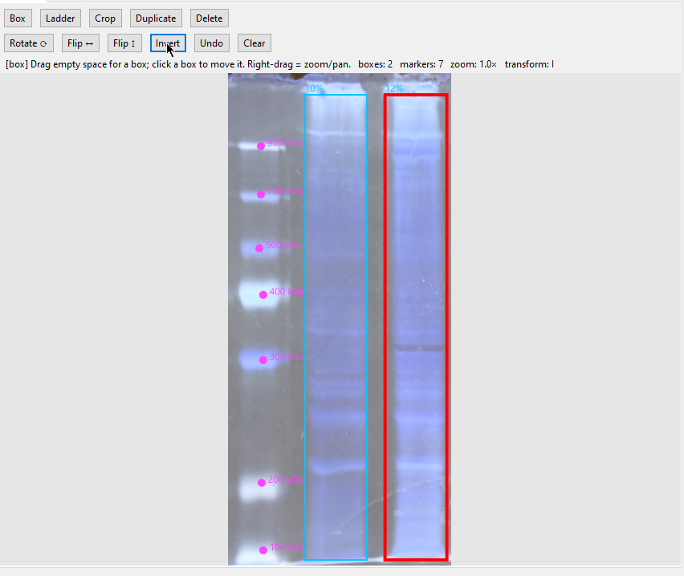

   The real example after applying Invert; the 10% and 12% boxes remain
   aligned with the same regions of the gel.

3. Crop the image
~~~~~~~~~~~~~~~~~

Optionally crop the image to the gel, membrane, or other region that should
be analyzed.

.. TODO: insert a real screenshot of the Crop step

4. Mark lanes and the ladder
~~~~~~~~~~~~~~~~~~~~~~~~~~~~

Draw one box around each lane or individual band. The box list records the
analysis regions and their labels. For molecular-weight calibration, tag the
ladder and either select a supported preset or enter at least two manual
marker positions and their kDa values.

**The real annotation example shows the box list and the manual ladder
fields used for calibration.**

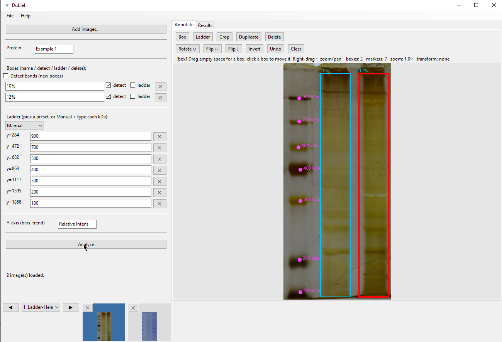

   Two lane boxes are labelled 10% and 12%, and seven manual ladder kDa
   values from 900 to 100 are entered beside the image.

5. Analyze
~~~~~~~~~~

Select the visible **Analyze** button after the boxes, labels, and ladder
values have been checked. Dubiel detects and integrates the bands in
automatic lane boxes; a manually selected single-band box is quantified as
one background-adjusted region.

6. Read the results
~~~~~~~~~~~~~~~~~~~

The Results tab presents the quantified output. The Z-profile plot is an
electropherogram: its horizontal coordinate is relative migration distance
and its vertical coordinate is background-subtracted intensity. Detected
bands are marked on the plotted profiles.

**The Results tab displays the measured profiles for the two real lanes.**

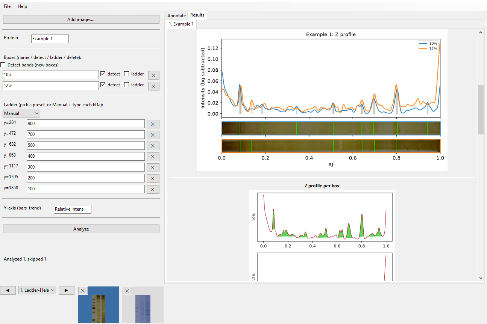

   The real 10% and 12% lane profiles are overlaid in the Z-profile plot,
   with detected bands marked.

.. usage-end

.. examples-start

Actual analysis run
~~~~~~~~~~~~~~~~~~~

This sequence follows one real gel photograph through loading, annotation,
intensity inversion, and inspection of the detected-band profiles.

**The analysis begins with an unmodified photograph of the gel.**

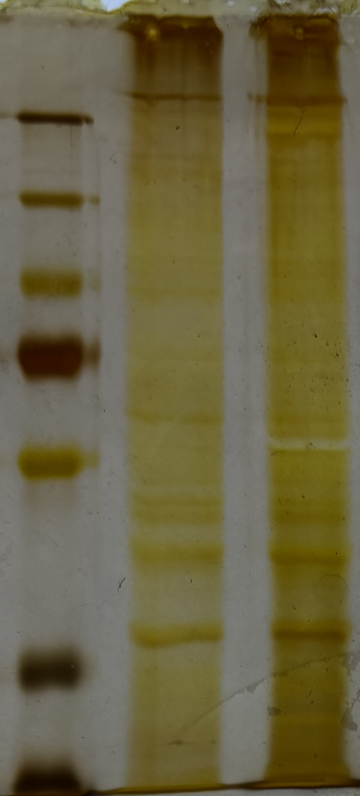

   The source photograph used for the real Dubiel screenshots.

**The relevant lanes and manual molecular-weight markers are then
annotated.**

   The Annotate tab with the 10% and 12% boxes and the seven-point manual
   ladder.

**Inverting the image provides the transformed view used in this run.**

.. figure:: ../images/app_invert_real.png
   :width: 65%
   :alt: Real gel after application of the Invert transform

   The same gel and boxes after Invert has been applied consistently to the
   displayed and analyzed images.

**The resulting electropherogram shows the signal measured in each box.**

.. figure:: ../images/app_results_real.png
   :width: 100%
   :alt: Results from the real gel analysis

   The Results tab with the two background-subtracted Z profiles and their
   detected bands.

The signal-processing path is not specific to one stain. For example, the
following source image is a second real, Coomassie-stained gel.

**A Coomassie-stained gel provides a second real input example.**

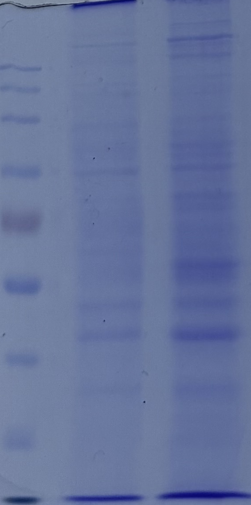

   A real Coomassie-stained gel photograph suitable for the same
   box-and-profile workflow.

Ground-truth validation
~~~~~~~~~~~~~~~~~~~~~~~

The following figures were generated by ``generate_demo_assets.py`` through
the actual analysis engine. The known ladder was
``LADDER_KDA = [100, 70, 50, 35, 25]`` kDa. Sample lanes were
``Control``, ``MG132``, ``MLN4924``, and ``Bortezomib``. Their encoded
percent-of-control values were:

- ``TargetProtein``: 100, 42, 68, and 30%;
- ``LoadingControl``: 100, 97, 101, and 99%;
- ``LC3II``: 100, 210, 165, and 240%.

Two independently rendered replicates per protein include photon noise,
illumination gradients, lane-position jitter, and +/-5% signal jitter. The
recovered molecular-weight calibration had :math:`r^2 > 0.999`, and the
recovered lane responses retained the encoded relative-intensity values and
ordering.

**The single-gel overlay checks box placement, ladder detection, and band
localization.**

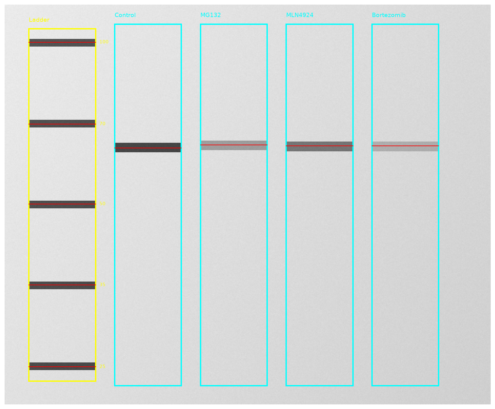

   The five known ladder bands are enclosed by the yellow ladder box, and
   the four ``LANES`` sample bands are detected in red. Their recovered
   molecular-weight fit had :math:`r^2 > 0.999`, and their intensities
   matched the ``TRUE_PCT["TargetProtein"]`` input pattern.

**The electropherogram checks detection and integration on the one-dimensional
lane profiles.**

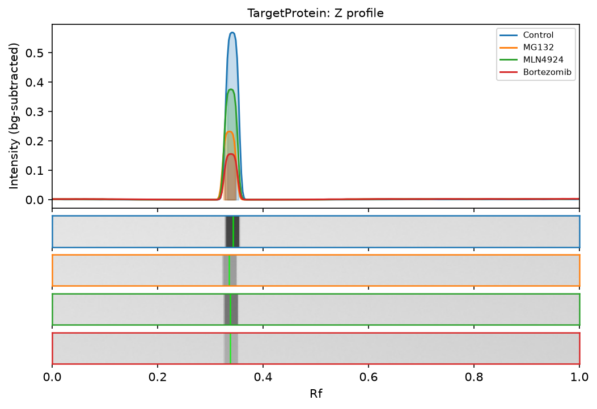

   Intensity versus relative migration is shown for the four known lanes.
   Peak positions agree with the ``LADDER_KDA`` calibration, and integrated
   responses reproduce the 100, 42, 68, and 30% TargetProtein pattern.

**The montage checks that the marked image regions correspond to the
quantified lanes.**

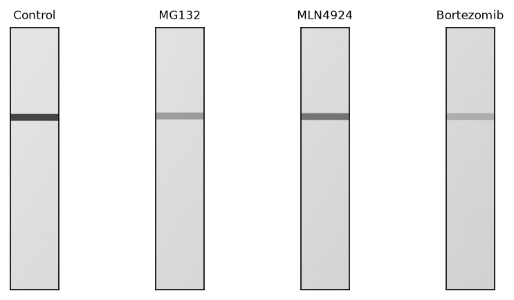

   Crops for ``Control``, ``MG132``, ``MLN4924``, and ``Bortezomib`` are
   shown in their defined ``LANES`` order; their quantified responses match
   the encoded TargetProtein ground truth, with MW-calibration
   :math:`r^2 > 0.999`.

**The three-dimensional view checks the image-level background correction.**

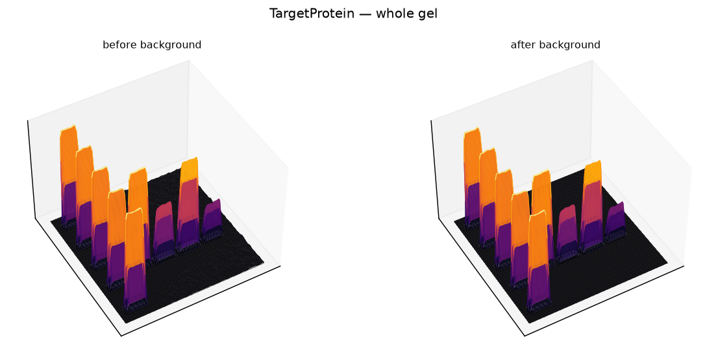

   Raw and background-subtracted intensity surfaces are shown for the
   synthetic gel containing the known ``LADDER_KDA`` and ``TRUE_PCT``
   signals. The downstream recovered MW and lane-response values match those
   inputs.

**The per-gel heatmap compares the known lane profiles by rank
correlation.**

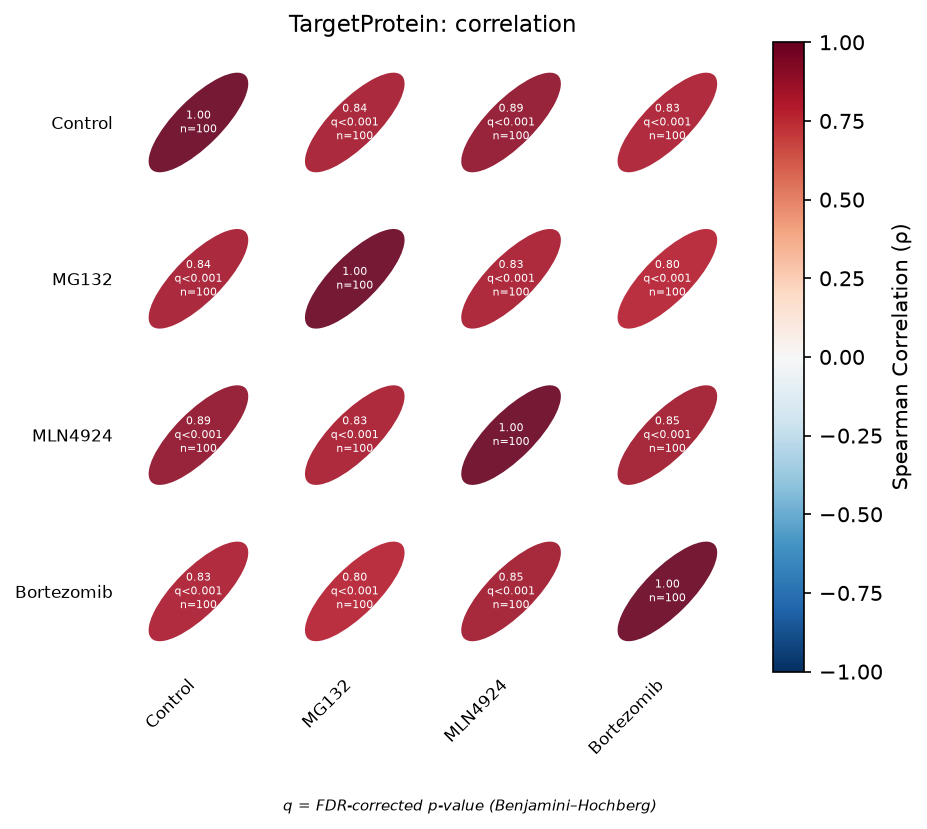

   Spearman :math:`\rho`, Benjamini-Hochberg-adjusted q-values, and sample
   counts are calculated from the four ``LANES`` profiles whose intensities
   reproduce the TargetProtein ground truth; their shared MW calibration had
   :math:`r^2 > 0.999`.

**The combined panel checks lane alignment and normalization across proteins
and replicates.**

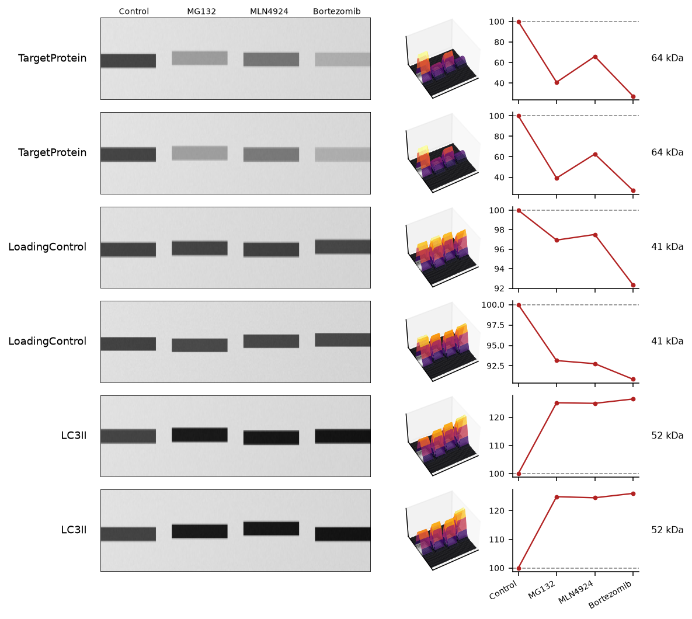

   TargetProtein, LoadingControl, and LC3II are aligned in shared ``LANES``
   columns. Each row derives from the known ``LADDER_KDA`` and ``TRUE_PCT``
   inputs, whose recovered MW fits exceeded :math:`r^2 = 0.999` and whose
   normalized trends match the encoded responses.

**The grouped statistics view checks replicate aggregation and significance
testing.**

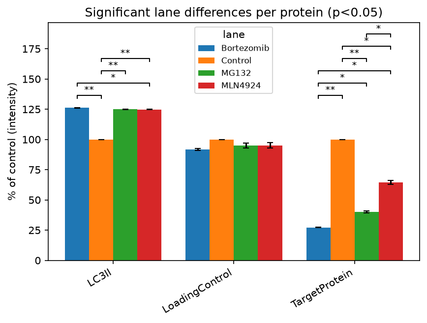

   Means and SEM are calculated from two synthetic replicates per protein.
   The bars recover the three ``TRUE_PCT`` patterns, and the brackets report
   significant Welch comparisons using the same validated
   :math:`r^2 > 0.999` MW-calibrated results.

**The protein-correlation view compares treatment responses between the
three known proteins.**

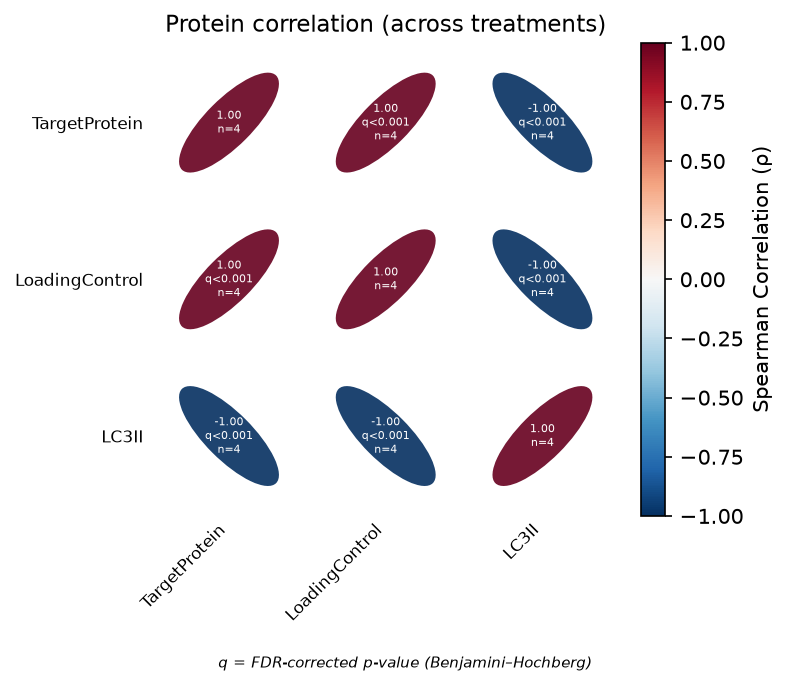

   The axes contain TargetProtein, LoadingControl, and LC3II; their
   correlations are calculated from the four known ``LANES`` responses after
   recovery of the ``TRUE_PCT`` values and :math:`r^2 > 0.999` MW
   calibrations.

**The treatment-correlation view compares the known treatments across
proteins.**

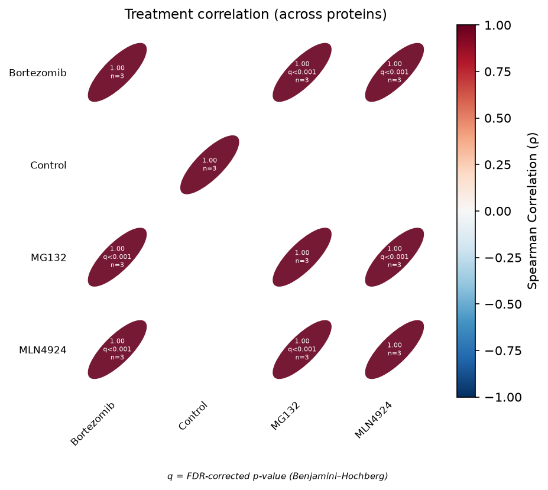

   The axes contain ``Control``, ``MG132``, ``MLN4924``, and
   ``Bortezomib``. The input values are the three ``TRUE_PCT`` series, and
   the plotted correlations use the recovered responses from the validated
   ladder-calibrated analyses.

**The decay example checks recovery of a known exponential time course.**

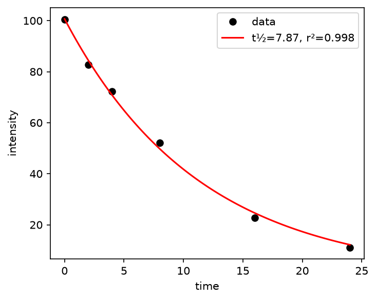

   Synthetic observations were generated from
   :math:`y=100\exp(-0.085t)` with small random noise. Fitting the same model
   recovered the expected half-life with :math:`r^2 \approx 0.998`.

.. examples-end

.. methodology-start

Image loading and normalization
~~~~~~~~~~~~~~~~~~~~~~~~~~~~~~~

``detect.load_image`` reads the source image and returns an RGB display image
and a grayscale analysis image. Grayscale inputs are expanded to RGB for
display, multipage or stack TIFF input uses the first page, and alpha
channels are removed. A non-8-bit image is scaled by its observed maximum
into the 0-255 range rather than being cast with integer wraparound.

Images whose longest edge exceeds 2000 pixels are downscaled with
anti-aliasing while preserving the aspect ratio. The grayscale image is
represented as floating-point values in the interval :math:`[0,1]`.
Downscaling changes the sampling resolution but preserves the band ratios
used for relative quantification.

Transforms
~~~~~~~~~~

``lanes.apply_transform`` applies transformations in the order 90-degree
rotation, horizontal flip, vertical flip, and inversion. The identical
operation is performed on the RGB display image and grayscale analysis
image. For inversion,

:math:`I_{\mathrm{inv}} = 1-I`

for the grayscale image, while the 8-bit display image is transformed as
:math:`I_{\mathrm{RGB,inv}}=255-I_{\mathrm{RGB}}`.

Background flattening
~~~~~~~~~~~~~~~~~~~~~

``detect.band_signal`` converts dark bands into positive signal and removes
slow illumination variation. It first calculates :math:`I_{\mathrm{inv}}`
and then forms

:math:`S = \max(I_{\mathrm{inv}}-G_{\sigma}(I_{\mathrm{inv}}),0)`,

where :math:`G_{\sigma}` is a Gaussian blur and the default
:math:`\sigma=40` pixels. Subtracting the blurred copy suppresses gradual
illumination gradients; clipping prevents negative residuals from
contributing to band intensity.

Lane-profile extraction
~~~~~~~~~~~~~~~~~~~~~~~

For a marked box, ``lanes._lane_bands`` crops :math:`S` and averages across
the box width at each vertical position. If a box has width :math:`w`, its
one-dimensional profile is

:math:`p(y)=\frac{1}{w}\sum_x S(y,x)`.

``detect.smooth_profile`` applies a one-dimensional Gaussian filter with

:math:`\sigma_p=\max(0.004n,1)`,

where :math:`n` is the profile length in pixels. Relative migration is saved
as

:math:`R_f=(y-y_0)/(y_1-y_0)`

for a box extending from :math:`y_0` to :math:`y_1`.

Band detection
~~~~~~~~~~~~~~

``detect.detect_bands`` calls ``scipy.signal.find_peaks`` on the smoothed
profile. A peak must have prominence of at least 10% of the lane maximum.
The minimum peak separation is :math:`\max(0.02n,2)` pixels. Peaks in the
outer 3% of either profile end are removed to suppress well, gel-front, and
crop-edge features.

Band integration
~~~~~~~~~~~~~~~~

For an automatically analyzed lane, ``results.integrate_band`` uses
``scipy.signal.peak_widths`` with ``rel_height=0.9`` to define the left and
right integration limits. A straight line between the profile values at
those limits is the local baseline. If :math:`b_i` is that baseline, the
reported band volume is

:math:`V_{\mathrm{band}}=\sum_i\max(p_i-b_i,0)`.

The integration is therefore performed on the same smoothed profile used
for detection, and only signal above the local straight baseline is summed.

A manually selected single-band box follows the separate
``lanes._box_volume`` path. With the default three-pixel outer padding, the
mean signal in the ring immediately outside the box estimates local
background. For box area :math:`A` and ring mean
:math:`\overline{S}_{\mathrm{ring}}`, adjusted volume is

:math:`V_{\mathrm{adj}}=\max\left(\sum_{\mathrm{box}}S-
\overline{S}_{\mathrm{ring}}A,0\right)`.

The results table preserves both the unadjusted box ``volume`` and the
background-subtracted ``adjusted_volume``. Automatic bands use their
baseline-integrated band volume for both fields.

Molecular-weight calibration
~~~~~~~~~~~~~~~~~~~~~~~~~~~~

``ladder.fit_mw`` fits the marked ladder points by least squares in
logarithmic molecular-weight space:

:math:`\log_{10}(\mathrm{MW})=md+b`.

For migration distance :math:`d`, the predicted molecular weight is

:math:`\widehat{\mathrm{MW}}=10^{md+b}`.

The function reports slope :math:`m`, intercept :math:`b`, and

:math:`r^2=1-\frac{\sum_i(y_i-\widehat{y}_i)^2}
{\sum_i(y_i-\overline{y})^2}`,

where :math:`y_i=\log_{10}(\mathrm{MW}_i)`. At least two marker points are
required. In ``lanes._calibrate``, a valid typed manual ladder overrides a
preset. Otherwise, exactly one box must be tagged as the ladder, and the
strongest detected peaks are matched in positional order to the selected
kDa list.

Results and per-gel normalization
~~~~~~~~~~~~~~~~~~~~~~~~~~~~~~~~~

``lanes.analyze_lanes`` writes one row per detected or manually selected
band. The table includes image and gel labels, lane label, ladder status,
band index, pixel position, estimated molecular weight, :math:`R_f`,
integration mode, volume, adjusted volume, lane total, and percent of lane.

``viz.gel_trend`` sums ``adjusted_volume`` by lane and reports each lane
relative to the control lane:

:math:`P_j=100\,S_j/S_{\mathrm{control}}`.

A lane whose label contains ``control`` or ``ctrl`` is selected as the
reference; if none is present, the first lane is used. The reference is
therefore 100%.

Combined-gel statistics
~~~~~~~~~~~~~~~~~~~~~~~

``combine._normalized_signal`` performs the same normalization separately
within every protein and gel before combining measurements. This per-gel
normalization reduces differences caused by exposure scale. Replicates with
the same protein and lane labels are summarized by their arithmetic mean and
standard error of the mean.

``combine.stats_barchart`` compares each non-control lane with the control
using ``scipy.stats.ttest_ind(..., equal_var=False)``, which is Welch's
two-sample t-test. A comparison requires at least two replicate measurements
in each lane. Significance is displayed as ``*`` for :math:`p<0.05`, ``**``
for :math:`p<0.01`, and ``***`` for :math:`p<0.001`.

Correlation
~~~~~~~~~~~

``correlate._corr_matrix`` computes pairwise Spearman rank correlation using
pairwise-complete observations. At least three shared, finite observations
are required, and both variables must vary. Off-diagonal p-values are
corrected together with ``scipy.stats.false_discovery_control`` using the
Benjamini-Hochberg method.

Each ellipse-heatmap cell reports Spearman :math:`\rho`, the FDR-corrected
q-value, and :math:`n`. For per-gel correlations,
``correlate.gel_correlation`` interpolates each non-ladder lane profile onto
100 equally spaced relative-migration points. For combined correlations,
``correlate.combined_correlations`` averages replicate gels with the same
protein label before correlating proteins across treatments or treatments
across proteins.

Exponential decay and half-life
~~~~~~~~~~~~~~~~~~~~~~~~~~~~~~~

``combine.fit_decay`` requires at least three time points and fits

:math:`y(t)=a\exp(-kt)`

with nonlinear least squares through ``scipy.optimize.curve_fit``. It
reports :math:`a`, :math:`k`, the coefficient of determination, and the
half-life

:math:`t_{1/2}=\ln(2)/k`

when :math:`k>0`. A non-positive fitted :math:`k` produces an infinite
half-life.

.. methodology-end

.. framework-start

Dubiel is implemented for Python 3.11 or later. Its native cross-platform
interface uses BeeWare Toga, and BeeWare Briefcase builds the Windows MSI,
macOS DMG, and Linux AppImage packages with the Python runtime included.
The core dependencies declared in ``pyproject.toml`` are NumPy, pandas,
SciPy, scikit-image, Matplotlib, and Pillow; platform-specific Toga backends
provide the native interface.

.. framework-end
